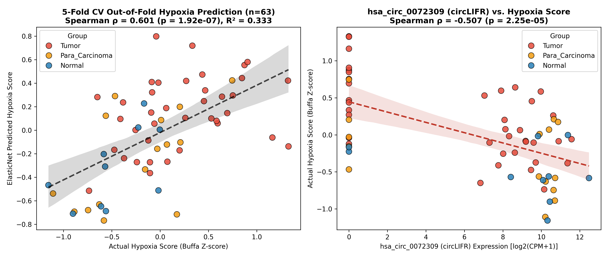
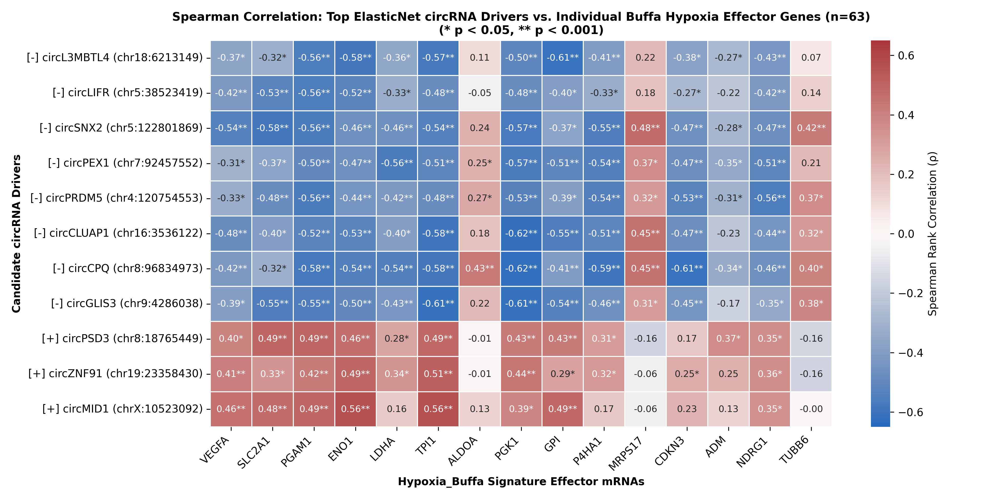
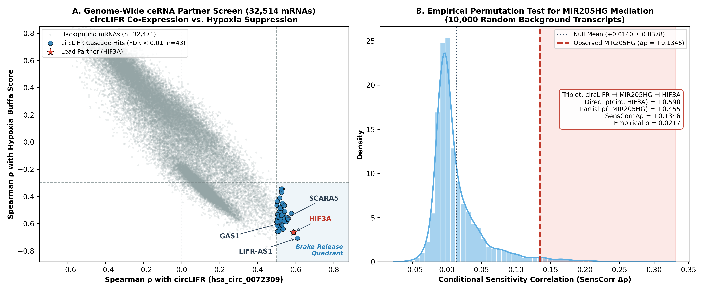
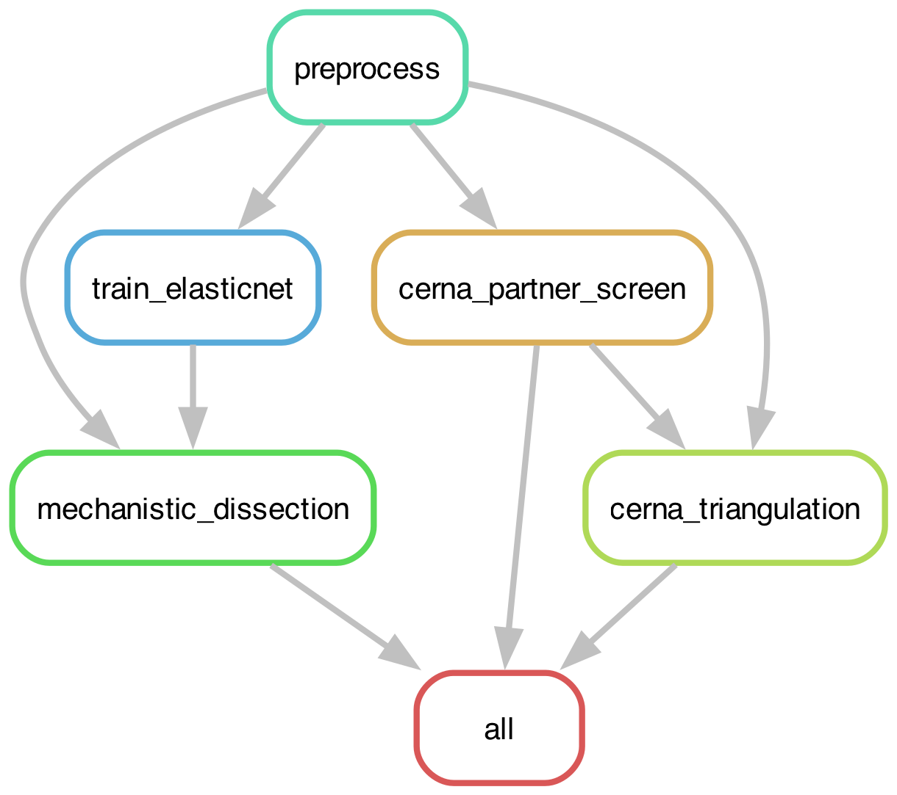

# circDriver
Machine learning project for identifying cancer driver of circular RNAs for a dataset GSE236932
# In Silico Prioritization and ceRNA Triangulation of Hypoxia-Associated circRNAs in Bladder Cancer (`GSE236932`)

A reproducible, **Snakemake-orchestrated** bioinformatics pipeline integrating regularized machine learning (`ElasticNetCV`), partial-correlation host-gene controls, and *in silico* competing endogenous RNA (ceRNA) triangulation to identify circular RNA (circRNA) regulators associated with tumor hypoxia in urothelial bladder carcinoma.

---

## 1. Study Motivation & Experimental Narrative (Stages 01–05)

Standard differential expression analysis of bulk total RNA-seq typically identifies hundreds of dysregulated non-coding RNAs without separating active regulatory candidates from passive transcriptional passengers of host-gene expression. Using matched circRNA and mRNA profiles from **GSE236932** ($n = 63$: 38 bladder tumors, 15 para-carcinoma tissues, 10 normal urothelial tissues), this study was structured as a five-stage funnel in which each computational finding motivated the next mechanistic test.

### Stage 01 (`01_preprocess.py`): Quantifying Continuous Microenvironment Targets
Rather than collapsing tissue biology into a binary Tumor-vs-Normal label, raw circRNA junction counts were normalized to $\log_2(\text{CPM} + 1)$ and paired with aggregated $\log_2(\text{FPKM/TPM} + 1)$ linear mRNA profiles across all 63 aligned samples. Three hallmark tumor microenvironment (TME) programs were scored per sample as mean row-wise Z-scores:
* **`Hypoxia_Buffa`** (15/15 genes): significantly elevated in tumors vs. normal urothelium ($t = 3.93, p = 2.82 \times 10^{-4}$; mean Z-score $+0.225$ in Tumor vs. $-0.250$ in Para-Carcinoma and $-0.480$ in Normal).
* **`EMT_Invasion`** (14/14 genes): significantly depleted in bulk tumor vs. normal stroma ($t = -3.41, p = 1.36 \times 10^{-3}$).
* **`Immune_Exhaustion_TME`** (12/12 genes): no significant global separation ($t = -1.57, p = 0.124$).

Because **`Hypoxia_Buffa`** showed the strongest and most biologically coherent monotonic gradient from normal urothelium through para-carcinoma tissue to invasive tumor, it was selected as the continuous prediction target ($Y$).

### Stage 02 (`02_train_elasticnet.py`): Blind Out-of-Fold Driver Prioritization
To test whether circRNA expression alone predicts tumor hypoxia without data leakage, consistently expressed circRNAs ($3,577$ loci with $\log_2(\text{CPM}+1) \ge 1.0$ in $\ge 19$ samples) were modeled inside a **5-fold stratified cross-validation** pipeline (`StandardScaler` $\rightarrow$ `SelectKBest(f_regression, k=50)` $\rightarrow$ `ElasticNetCV`, preserving tissue group proportions in every fold).

* **Generalization Performance:** Out-of-fold predictions tracked actual Buffa hypoxia scores blindly with **$R^2 = 0.333$**, **Spearman $\rho = 0.601$ ($p = 1.92 \times 10^{-7}$)**, **Pearson $r = 0.587$ ($p = 4.32 \times 10^{-7}$)**, and **$\text{MAE} = 0.361$**.
* **Lead Candidates:** Ranking features by cross-fold selection stability prioritized two predominantly silenced ("loss-of-brake") drivers: **`circL3MBTL4`** (`chr18:6213149|6312056`, selected in $5/5$ folds, mean $\text{coef} = -0.0793$) and **`circLIFR` / `hsa_circ_0072309`** (`chr5:38523419|38530666`, selected in $4/5$ folds, strongest weight magnitude $\text{coef} = -0.0857$, direct $\rho = -0.507, p = 2.25 \times 10^{-5}$).

<!--  -->

### Stage 03 (`03_mechanistic_dissection.py`): Host-Gene Independence & Effector Mapping
A core confounder in circRNA biology is transcriptional hitchhiking—a circRNA may appear hypoxia-linked purely because its linear parent gene is co-regulated. Using a resilient multi-provider GRCh38 annotator (`Ensembl` $\rightarrow$ `MyGene.info` $\rightarrow$ `UCSC` with persistent local caching), all top ElasticNet loci were mapped to host genes and evaluated via **partial Spearman correlation** controlling for linear host mRNA abundance:

* **Host Independence:** Neither **`circL3MBTL4`** (partial $\rho = -0.583$ vs. linear *L3MBTL4* $\rho = +0.020$) nor **`circLIFR`** (partial $\rho = -0.488$ vs. linear *LIFR* $\rho = -0.161$) is explained by host promoter silencing.
* **Circular-to-Linear Splice Switching:** Two additional drivers—**`SNX2`** ($\rho_{\text{circ}} = -0.544$ vs. linear $\rho = +0.388$) and **`PEX1`** ($\rho_{\text{circ}} = -0.585$ vs. linear $\rho = +0.284$)—showed opposing circular and linear trajectories under hypoxia, consistent with hypoxia-linked alternative back-splicing.
* **Effector Specificity:** Mapping the 8 negative and 3 positive ElasticNet drivers against all 15 individual Buffa mRNAs confirmed that loss of these circRNAs specifically correlates with derepression of the **core anaerobic glycolysis (Warburg) block** (`SLC2A1`, `PGAM1`, `ENO1`, `TPI1`, `PGK1`, `GPI`) and **`VEGFA`**.



### Stage 04 (`04_cerna_partner_screen.py`): The "Brake-Release" Rationale & Divergent Mechanisms
Stage 03 raised a mechanistic sign question: **`circLIFR` is negatively correlated with hypoxia and glycolytic mRNAs**, yet under the canonical post-transcriptional **ceRNA (miRNA sponge) model**, a circRNA and its protected partner mRNA must shift in the **same direction** (double inhibition $\text{circRNA} \dashv \text{miRNA} \dashv \text{mRNA}$ produces positive co-expression).

Therefore, if `circLIFR` suppresses hypoxia via a ceRNA mechanism, it must protect an intermediate **hypoxia suppressor ("brake")** whose loss releases glycolytic transcription in tumors. To test this hypothesis unbiasedly, all **32,514 expressed mRNAs** ($\log_2 > 1$ in $\ge 20$ samples) were screened for transcripts meeting three simultaneous criteria: strong positive co-expression with the circRNA ($\rho > 0.5$), Benjamini–Hochberg FDR $q < 0.01$, and negative correlation with hypoxia ($\rho_{\text{Hypoxia}} < -0.3$).

* **`circLIFR` Anchors a Dense Brake-Release Network (43 hits):** Among the 43 passing mRNAs, **`HIF3A`** emerged at the top of the protein-coding hits ($\rho_{\text{circ}} = +0.5898, q = 0.0030 \mid \rho_{\text{Hypoxia}} = -0.6634$), alongside `LIFR-AS1` ($\rho = +0.6085$) and tumor suppressors `GAS1` ($\rho = +0.5501$) and `SCARA5` ($\rho = +0.5420$). Biologically, **`HIF3A`** encodes a canonical dominant-negative inhibitor of HIF-1$\alpha$—directly linking `circLIFR` loss to derepression of the HIF-1$\alpha$ glycolytic program.
* **Divergent Mechanism for `circL3MBTL4` (4 hits):** Running the identical genome-wide screen on `circL3MBTL4` returned only 4 cascade hits (`EPHA5-AS1`, `WASF1P1`, `TUB`, `HBA1`), indicating that despite equally strong host-independent hypoxia association, `circL3MBTL4` likely operates via a **non-ceRNA mechanism** (e.g., RNA-binding protein scaffolding or nuclear transcriptional control).

### Stage 05 (`05_cerna_triangulation.py`): Sequence & Statistical Mediation Triangulation
To evaluate whether candidate miRNAs bridge `circLIFR` and `HIF3A` without over-relying on raw co-expression, Stage 05 combined two orthogonal *in silico* tests across a **miRBase-verified** 8-family candidate miRNA panel:

1. **Canonical Spliced 3'UTR MRE Scanning (Sequence Layer):** Programmatic extraction of canonical protein-coding spliced 3'UTRs from Ensembl (`HIF3A`: 3,811 bp; `GAS1`: 1,380 bp; `SCARA5`: 2,051 bp) and exact 7mer-m8/8mer reverse-complement scanning across both `circLIFR` (7,248 bp genomic span) and partner 3'UTRs identified three shared binding bridges:
   * **`hsa-miR-200a/141` (`MIMAT0000682`, 7mer-m8 `CAGTGTT`):** shared across `circLIFR`, **`HIF3A` 3'UTR**, and **`GAS1` 3'UTR**.
   * **`hsa-miR-34a-5p` (`MIMAT0000255`, 7mer-m8 `CACTGCC`):** shared across `circLIFR` and `GAS1` 3'UTR.
   * **`hsa-miR-145-5p` (`MIMAT0000437`, 7mer-m8 `AACTGGA` + 8mer `AACTGGAA`):** shared across `circLIFR` and `SCARA5` 3'UTR.
2. **Empirical Permutation Mediation Test (Expression Layer):** Because bulk total RNA-seq does not sequence mature ~22-nt miRNAs directly, primary miRNA host transcripts expressed in `GSE236932` were tested as statistical mediators via **Conditional Sensitivity Correlation (`SensCorr`)**:
   $$\text{SensCorr} = \Delta\rho = \rho(\text{circLIFR}, \text{HIF3A}) - \rho(\text{circLIFR}, \text{HIF3A} \mid \text{Mediator})$$
   Conditioning on **`MIR205HG`** reduced the `circLIFR`–`HIF3A` correlation from $+0.590$ to $+0.455$ ($\Delta\rho = +0.1346$). Against a **10,000-transcript empirical null** drawn from the expressed transcriptome (mean $\Delta\rho = +0.0140 \pm 0.0378$), `MIR205HG` achieved an empirical permutation **$p = 0.0217$**—confirming that its shared variance with the `circLIFR`–`HIF3A` pair exceeds 97.8% of background transcripts.

> **Interpretive Boundary:** Bulk RNA-seq triangulation nominates testable mechanisms rather than proving physical binding. Notably, **`hsa-miR-200a/141`** provides the canonical 7mer-m8 sequence bridge across `circLIFR` and `HIF3A`, whereas **`MIR205HG`** supplies the strongest statistical expression-mediation signal despite lacking a canonical 7mer-m8 site in both sequences—pointing to either non-canonical/6mer interaction or indirect co-regulation for `MIR205HG` that warrants direct mature miRNA testing.



---

## 2. Summary of Key Quantitative Findings

### Top Host-Independent Hypoxia-Linked circRNA Drivers (`GSE236932`, $n = 63$)

| circRNA Locus (GRCh38) | Host Gene | 5-Fold Selection Freq | Mean ElasticNet Coef | $\rho(\text{circ, Hypoxia})$ | $\rho(\text{Linear Host, Hypoxia})$ | Partial $\rho(\text{circ} \mid \text{Host})$ |
| :--- | :--- | :---: | :---: | :---: | :---: | :---: |
| `chr18:6213149\|6312056` | `L3MBTL4` | `1.0` (5/5) | `-0.0793` | `-0.573` | `+0.020` | `-0.583` |
| `chr5:38523419\|38530666` | `LIFR` (`hsa_circ_0072309`) | `0.8` (4/5) | `-0.0857` | `-0.507` | `-0.161` | `-0.488` |
| `chr5:122801869\|122803613` | `SNX2` | `0.8` (4/5) | `-0.0213` | `-0.544` | `+0.388` | `-0.465` |
| `chr7:92457552\|92492286` | `PEX1` | `0.6` (3/5) | `-0.0427` | `-0.585` | `+0.284` | `-0.553` |
| `chr4:120754553\|120811449` | `PRDM5` | `0.6` (3/5) | `-0.0252` | `-0.545` | `+0.031` | `-0.545` |
| `chr16:3536122\|3536994` | `CLUAP1` | `0.6` (3/5) | `-0.0119` | `-0.559` | `+0.118` | `-0.552` |
| `chr8:96834973\|96880005` | `CPQ` | `0.6` (3/5) | `-0.0118` | `-0.572` | `+0.166` | `-0.557` |
| `chr9:4286038\|4286523` | `GLIS3` | `0.6` (3/5) | `-0.0071` | `-0.524` | `+0.172` | `-0.535` |
| `chr8:18765449\|18940293` | `PSD3` | `0.2` (1/5) | `+0.0236` | `+0.513` | `+0.609` | `+0.383` |
| `chr19:23358430\|23362739` | `ZNF91` | `0.2` (1/5) | `+0.0168` | `+0.454` | `+0.525` | `+0.350` |
| `chrX:10523092\|10567603` | `MID1` | `0.2` (1/5) | `+0.0106` | `+0.473` | `+0.524` | `+0.438` |

### miRBase-Verified Candidate miRNA Panel (Stage 05)

| miRNA Family (Host Proxy) | miRBase Accession | 5' Seed (nt 2–8) | Target 7mer-m8 MRE | Shared Spliced 3'UTR Hit (`circLIFR` $\leftrightarrow$ Partner) |
| :--- | :--- | :---: | :---: | :--- |
| `hsa-miR-200a/141` (`MIR200A`) | `MIMAT0000682` | `AACACUG` | `CAGTGTT` | **`HIF3A` (1), `GAS1` (1)** |
| `hsa-miR-34a-5p` (`MIR34AHG`) | `MIMAT0000255` | `GGCAGUG` | `CACTGCC` | **`GAS1` (1)** |
| `hsa-miR-145-5p` (`MIR145`) | `MIMAT0000437` | `UCCAGUU` | `AACTGGA` | **`SCARA5` (1)** *(8mer on `circLIFR`)* |
| `hsa-miR-205-5p` (`MIR205HG`) | `MIMAT0000266` | `CCUUCAU` | `ATGAAGG` | *Statistical mediator ($\Delta\rho = +0.1346, p = 0.0217$)* |
| `hsa-miR-200b/c/429` (`MIR200CHG`) | `MIMAT0000318` | `AAUACUG` | `CAGTATT` | None shared |
| `hsa-miR-210-3p` (`MIR210HG`) | `MIMAT0000267` | `UGUGCGU` | `ACGCACA` | None shared |
| `hsa-miR-17-5p/20a` (`MIR17HG`) | `MIMAT0000070` | `AAAGUGC` | `GCACTTT` | None shared |
| `hsa-miR-1-3p` (`MIR1-1HG`) | `MIMAT0000416` | `GGAAUGU` | `ACATTCC` | None shared |

---

## 3. Workflow Architecture & Reproducibility



```text
GSE236932-circDriver/
├── Snakefile                         # Master Snakemake DAG workflow
├── config/config.yaml                # Centralized thresholds, signatures, & CV parameters
├── envs/circdriver.yaml              # Conda environment specification
├── requirements.txt                  # Pinned pip dependencies
├── Data/                             # Raw GEO matrices (GSE236932)
├── Scripts/
│   ├── 01_preprocess.py              # Sample alignment, log2(CPM+1) norm, Z-score targets
│   ├── 02_train_elasticnet.py        # Leak-free 5-fold Stratified CV + ElasticNetCV
│   ├── 03_mechanistic_dissection.py  # Multi-API GRCh38 mapping, partial rho, & heatmaps
│   ├── 04_cerna_partner_screen.py    # Vectorized Spearman + BH FDR genome-wide screen
│   └── 05_cerna_triangulation.py     # Spliced 3'UTR MRE scan, permutation test, & Fig. 3
├── Notebooks/                        # Exploratory Jupyter notebooks (01–05)
└── Processed/                        # Generated CSVs, API caches, & 300-DPI figures
